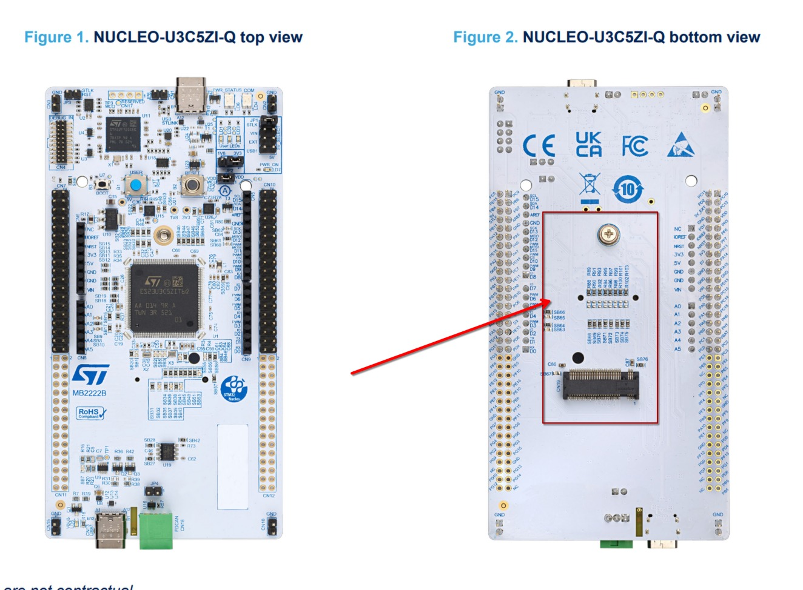
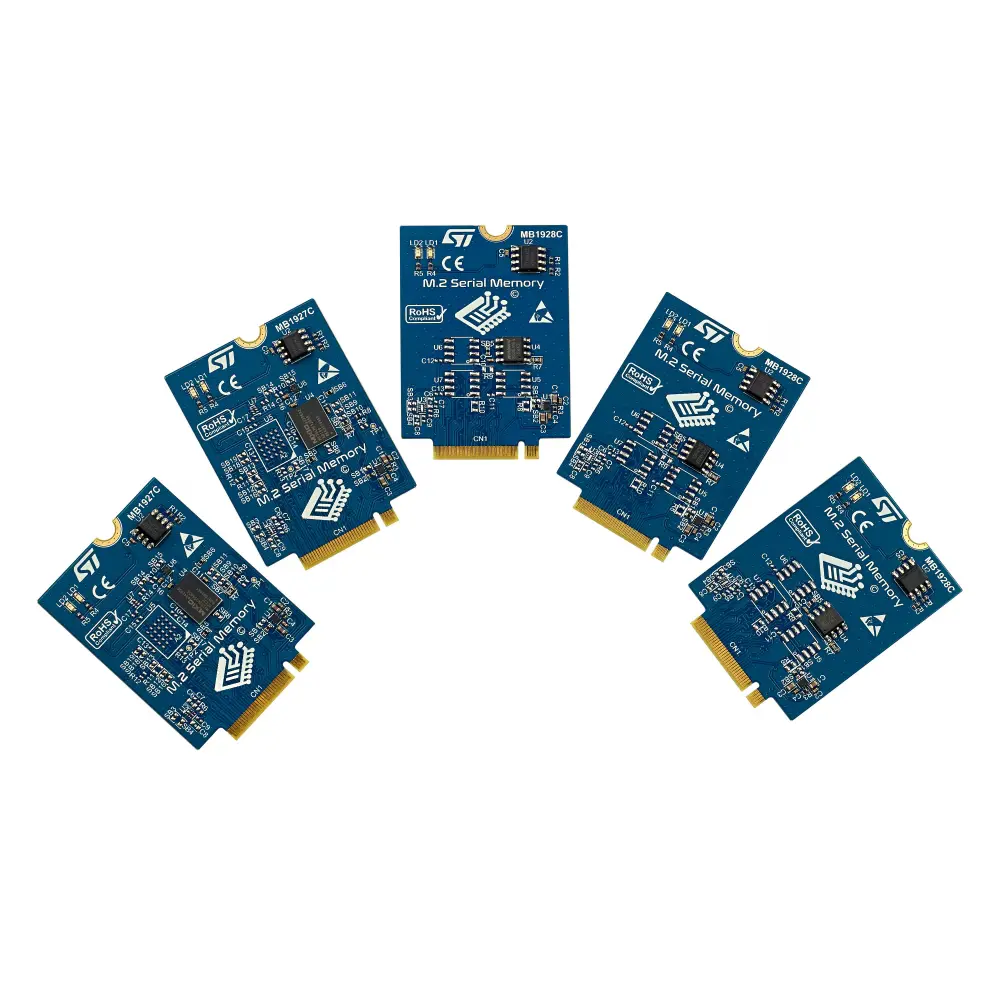

# Adding B_M2MEM_PACK1 shield support to Zephyr
- [PR #109004](https://github.com/zephyrproject-rtos/zephyr/pull/109004), merged **24.06.2026**.

## Intro
After I added upstream support for [STM32U3C5 SoC and NUCLEO-U3C5ZI-Q board](https://github.com/zephyrproject-rtos/zephyr/pull/105503), I observed the board and I got the idea to make one more contribution for it. I noticed that this board has a M.2 Key-A slot at the bottom side, and it spiked my curiosity.
After some research, I found out the intention behind this slot - the [B_M2MEM_PACK1](https://www.st.com/en/evaluation-tools/b-m2mem-pack1.html) shield.
<p align="center">
  
  <br>
  <em>The M.2 Key-A connector (highlighted) on the underside of the NUCLEO-U3C5ZI-Q, routed to the SoC's XSPI bus.</em>
</p>

## What is B_M2MEM_PACK1 shield?
This shield is a pack of five different non-volatile serial memory cards by STMicroelectronics. These cards contain serial flash memories from different memory vendors and offer multiple serial bus schemes and memory interfaces.

<p align="center">
  
  <br>
  <em>The B_M2MEM_PACK1 pack: a family of M.2 serial-memory cards (MB1927C / MB1928C) - each variant became its own shield overlay.</em>
</p>

## Zephyr shields - short recap
In Zephyr, a shield is defined by two key characteristics:
1. **Physical connectors** - the mechanical interface
2. **Electrical signals** - what each pin actually does

The connection between the host boards and a shield it carries is being done by Devicetree files on the board and shield sides:
1. **Board side** - The boards side must have dedicated devicetree file (e.g. **arduino_r3_connector.dtsi**) which uses [GPIO Nexus nodes](https://docs.zephyrproject.org/latest/hardware/porting/shields.html#gpio-nexus-node). It is like an interface between SoC GPIO pins and pins on the shield itself. 
Example: Every board that supports the arduino_r3_connector, must have a file `arduino_r3_header.dtsi` which has the `arduino_header` GPIO Nexus node which maps pins exposed on the board's SoC to the common pin-names on the interface itself. It looks like this:
```
arduino_header: connector {
        compatible = "arduino-header-r3";
        #gpio-cells = <2>;
        gpio-map-mask = <0xffffffff 0xffffffc0>;
        gpio-map-pass-thru = <0 0x3f>;
        gpio-map = <0 0 &gpioa 0 0>,    /* A0 */
                   <1 0 &gpioa 1 0>,    /* A1 */
                   <2 0 &gpioa 4 0>,    /* A2 */
                   <3 0 &gpiob 0 0>,    /* A3 */
                   <4 0 &gpioc 1 0>,    /* A4 */
                   <5 0 &gpioc 0 0>,    /* A5 */
                   <6 0 &gpioa 3 0>,    /* D0 */
                   <7 0 &gpioa 2 0>,    /* D1 */
                   <8 0 &gpioa 10 0>,   /* D2 */
                   <9 0 &gpiob 3 0>,    /* D3 */
                   <10 0 &gpiob 5 0>,   /* D4 */
                   <11 0 &gpiob 4 0>,   /* D5 */
                   <12 0 &gpiob 10 0>,  /* D6 */
                   <13 0 &gpioa 8 0>,   /* D7 */
                   <14 0 &gpioa 9 0>,   /* D8 */
                   <15 0 &gpioc 7 0>,   /* D9 */
                   <16 0 &gpiob 6 0>,   /* D10 */
                   <17 0 &gpioa 7 0>,   /* D11 */
                   <18 0 &gpioa 6 0>,   /* D12 */
                   <19 0 &gpioa 5 0>,   /* D13 */
                   <20 0 &gpiob 9 0>,   /* D14 */
                   <21 0 &gpiob 8 0>;   /* D15 */
};
```
It also defines the labels for buses exposed on the connector:
```
arduino_i2c: &i2c1 {};

arduino_spi: &spi1 {};

arduino_serial: &lpuart1 {};
```


2. **Shield side** - Consists of shield devicetree files, more precise:
- **<shield_name>.overlay** - This files include the connector gpio bindings, i.e:
```
#include <zephyr/dt-bindings/gpio/arduino-header-r3.h>
```
and it can optionally define some root devicetree node which is used to define a new node, and probably define something unique to that shield (i.e. some LED's,...) which cannot be referenced by some other, existing node.
```
/ {
	my_shield {
		compatible = "vendor,my-shield";
		status = "okay";
	};
};
```
More importantly, this file references existing nodes (defined in connector devicetree files) and adapts them to the peripherals exposed on the shield, i.e.:
```
&arduino_spi {
	status = "okay";
	cs-gpios = <&arduino_header ARDUINO_HEADER_R3_D9 GPIO_ACTIVE_LOW>;
};
```

- **Kconfig.shield** - This file defines the Kconfig symbol for the shield
```
config SHIELD_<SHIELD_NAME>
	def_bool $(shields_list_contains,shield_<shield_name>)
```
- **shield.yaml** - This file defines what peripherals does the shield support
```
shield:
  name: <shield_name>
  full_name: <full_shield_name>
  vendor: <shield_vendor>
  supported_features:
    - <supported_features>
```


## The PR workflow
This PR has been a tough one, and I done it through eight commits, where every commit hronologically represents my flow of thinking, adaptations I made by respecting reviewers critics. 

### 1. XSPI controller support 
Commit: *dts: arm: st: stm32u3: add XSPI controller support* (74fba4a)

Firstly, by reading the official B_M2MEM_PACK1 and NUCLEO_U3C5ZI_Q docs, I noticed that the M.2 connector is tied to **XSPI** peripheral, so I jumped to the docs and [AN5050](https://www.st.com/resource/en/application_note/an5050-getting-started-with-octospi-hexadecaspi-and-xspi-interface-on-stm32-mcus-stmicroelectronics.pdf) had all answers I needed. Long story short, the **XSPI** - e**X**tended **S**erial **P**eripheral **I**nterface, is the new interface that responds to the growing demand for faster, bigger external memories, needed by richer graphics, wider range of multimedia and data-intensive applications in embedded systems, which require higher data throughputs and extra demands on the limited on-chip MCU memory. It is a flexible interface which can be configured as:

 1. **SPI** for 1-line data transmission
 2. **Dual-SPI** for 2-line data transmission
 3. **Quad-SPI** for 4-line data transmission
 4. **Octo-SPI** for 8-line data transmission
 5. **Hexadexa-SPI** for 16-line data transmission

I checked out the SoC devicetree files, and there wasn't XSPI node at all, I didn't include it in my SoC and board PR previously. I modified the `dts/arm/st/u3/stm32u3.dtsi` and added the node:
```
		xspi1: spi@420d1400 {
			compatible = "st,stm32-xspi";
			reg = <0x420d1400 0x400>, <0x90000000 DT_SIZE_M(256)>;
			interrupts = <76 0>;
			clock-names = "xspix", "xspi-ker";
			clocks = <&rcc STM32_CLOCK(AHB2_2, 4)>,
				 <&rcc STM32_SRC_SYSCLK OCTOSPI_SEL(0)>;
			#address-cells = <1>;
			#size-cells = <0>;
			status = "disabled";
		};
```
where:
- **xspi1** is the nodelabel of the spi node, but on the internal SoC address where XSPI1 peripheral begins `0x420d1400` - **unit address**
- **compatible** property describes which bindings will be used for this node - in short, which driver will be used for this node
- **reg** property has two address windows, first one is the **register block** - `<0x420d1400 0x400>` where first address matches unit address, and second one represents size of the register space; Second address window represents predefined address space reserved for **memory-mapped** mode, start address of the memory-mapped region is `0x90000000` and size of that region can be maximally 256MB (This is the maximal size of the external memory we can do memory-mapping with, limitation of address space) 
_! Note that we will have problem later on with this !_ 
- **interrupts** property has two values, where first one describes which IRQ line is used for this node - IRQ line 76 is the _OCTOSPI1 global interrupt_ in the STM32U3 vector table [RM0487](https://www.st.com/resource/en/reference_manual/rm0487-stm32u3-series-armbased-32bit-mcus-stmicroelectronics.pdf); Second value represents the Zephyr interrupt priority.
- **clock-names/clocks** properties have two clocks, and this can be a little bit confusing. These two clocks actually have two different jobs: 

	- **xspix**	-> `STM32_CLOCK(AHB2_2, 4)` is the bus clock where bit 4 selects (`OCTOSPI1EN`) of `RCC_AHB2ENR2` (_2 sufix means second AHB2 enable register). This is the gate that makes the peripheral's AHB ports alive, and with this being closed, access to peripheral registers triggers bus fault.
	- **xspi-ker** -> `<&rcc STM32_SRC_SYSCLK OCTOSPI_SEL(0)>` is the kernel clock, the one that actually clocks the peripheral. This clock actually produces the bus clock.
- **#address-cells / #size-cells** - describes how **child** nodes are addressed: 
```
	#address-cells = <1>; -> One address cell
	#size-cells = <0>; -> No size cell
``` 
means the child is written as a xspi-nor-flash@0 where 0 is the chip-select index, not a memory address. _! This will be a problem later on...!_
- **status = "disabled"** - The node initializes in a disabled state.

### 2. M.2 connector support
Commit: *dts: bindings: gpio: add ST M2 memory connector binding* (698ceed)

As mentioned earlier, the B-M2MEM-PACK1 attaches to Nucleo boards through an M.2 Key A connector. A shield is only portable if the connector it plugs into is described once, centrally, and then reused by every board that exposes it. Therefore, before implementing the shield itself, I first had to add support for the connector.

In Zephyr, connectors are described using two main components - **binding** and **header for pin macros**. This is what I implemented for M.2 memory connector:
1. **Binding** -  `dts/bindings/gpio/st,m2-memory-connector.yaml` - Defines the connector type and its devicetree representation as a GPIO nexus, and defines how GPIO specifiers `pin`, `flags` are interpreted.
2. **Header for pin macros** - `include/zephyr/dt-bindings/gpio/m2-memory-connector.h` - Defines connector pins, like:
```
...
#define M2MEM_CONNECTOR_GPIO_SPI_SCK  16 /**< Optional auxiliary SPI clock */
#define M2MEM_CONNECTOR_GPIO_SPI_MOSI 17 /**< Optional auxiliary SPI controller-out */
#define M2MEM_CONNECTOR_GPIO_LDO_EN   18 /**< Mandatory open-drain LDO enable */
#define M2MEM_CONNECTOR_GPIO_SPI_MISO 19 /**< Optional auxiliary SPI controller-in */
...
```
,where some shield that uses this connector can include this file in shield overlay file and reference this pins to a physical pins exposed on the shield itself. (**b_m2mem_pack1** shield in this case).

## 3. Board side connector definition
Commit: *boards: st: nucleo_u3c5zi_q: add M2 memory connector support* (1db9c2a)

This is actually the important one. 


TODO: Explain every commit by respecting hronology - feed the MSPI plot, and provide concrete reasons of the migration to MSPI API (Give detailed explanation of reg limitations that are being solved with MSPI) 